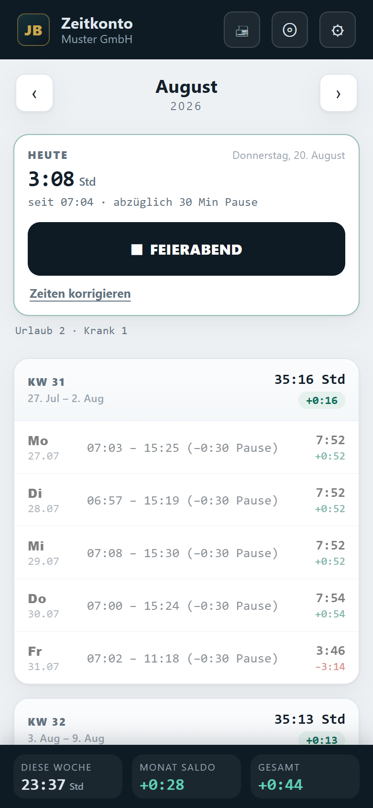
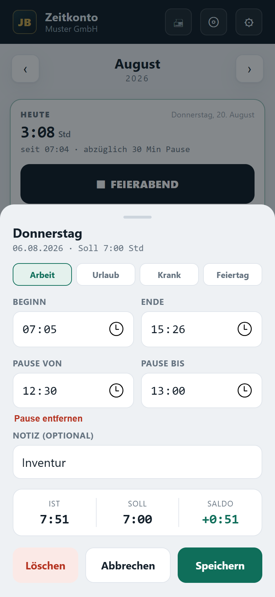
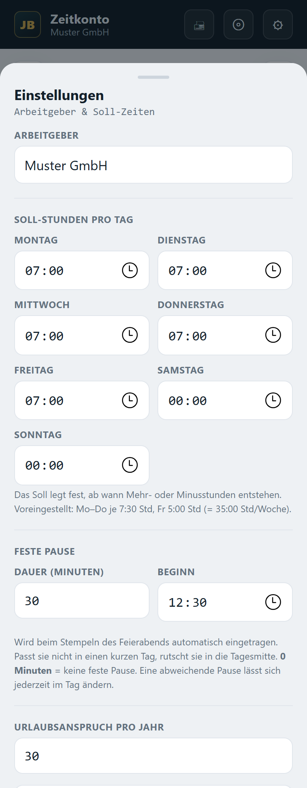
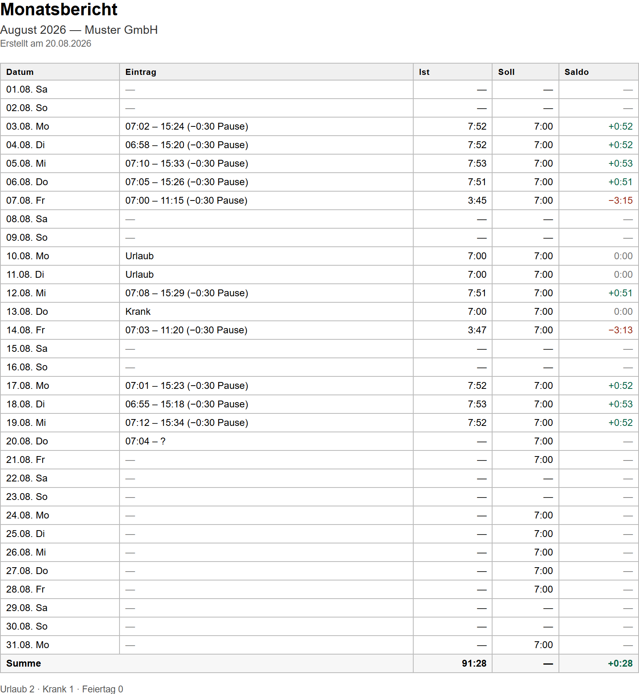

# Zeitkonto

Arbeitszeit erfassen mit zwei Tipps am Tag — als installierbare Web-App, die offline
läuft, kein Konto braucht und die Daten auf dem Gerät behält.

**→ [ronglueck.github.io/jb-zeitkonto](https://ronglueck.github.io/jb-zeitkonto/)**

<table>
  <tr>
    <td width="33%"></td>
    <td width="33%"></td>
    <td width="33%"></td>
  </tr>
  <tr>
    <td align="center"><em>Stempeln &amp; Saldo</em></td>
    <td align="center"><em>Tag korrigieren</em></td>
    <td align="center"><em>Soll, Pause, Erinnerungen</em></td>
  </tr>
</table>

## Wofür das gut ist

Diese App ist für eine einzelne Person gebaut, die jeden Tag dieselbe Frage hatte:
*Habe ich heute eigentlich schon eingetragen, wann ich angefangen habe?* Der übliche
Weg — abends vier Uhrzeiten aus dem Gedächtnis in ein Formular tippen — geht regelmäßig
schief. Also erfasst die App im Moment selbst:

**Morgens „Kommen", nachmittags „Feierabend".** Die Pause wird als feste Dauer
abgezogen, das Soll ist hinterlegt, der Saldo rechnet sich von allein. Wer es doch
vergisst, wird erinnert — aber nur dann, und nur an Arbeitstagen.

Dass die App so schlank ist, ist Absicht: keine Anmeldung, keine Cloud, keine
Frameworks, keine Tracker. Eine Datei, ein Browser, fertig.

## Was drin ist

**Erfassen**
- Stempeluhr für heute: *Kommen* → *Feierabend*, minutengenau, ohne Rundung
- Feste Pause (Dauer und Uhrzeit einstellbar), wird beim Feierabend automatisch abgezogen
- Jeden Tag von Hand korrigierbar: Beginn, Ende, Pause, Notiz
- Der Tageseditor markiert ungültige Zeiten rot und verhindert das Speichern.
  Bei fehlender Pause lässt sich die eingestellte Dauer übernehmen oder ausdrücklich
  ohne Pause speichern. Nach einer Korrektur wird die Änderung des Tages-Saldos angezeigt.
- Tagestypen **Urlaub**, **Krank**, **Feiertag** — saldo-neutral, mit Jahres-Zähler
- Hinweis, wenn an einem früheren Tag das Ende fehlt
- Startbildschirm-Verknüpfungen: App-Symbol gedrückt halten → *Kommen* / *Feierabend*

**Auswerten**
- Soll-Stunden je Wochentag frei einstellbar
- Saldo pro Tag, Woche, Monat und insgesamt (ISO-Kalenderwochen)
- Urlaubsanspruch mit „genommen / Rest" pro Jahr
- **Monatsbericht als PDF** über die Druckfunktion des Browsers — ohne Zusatzsoftware

**Erinnern** (optional, siehe [DEPLOY-PUSH.md](DEPLOY-PUSH.md))
- Push zum Arbeitsbeginn, zum Feierabend und als Tagescheck — Zeiten frei wählbar,
  eigene Feierabend-Zeit für Freitag
- Erinnert **nur, wenn der Eintrag wirklich noch fehlt**, und nur an Arbeitstagen
- Die Benachrichtigung hat einen Knopf, der direkt stempelt

**Drumherum**
- Läuft **offline** (Service Worker), installierbar als App
- Sicherung als JSON-Datei exportieren und wieder einlesen
- Wochenenden und Gesamtsaldo lassen sich ausblenden
- Kurzer Hinweis nach einem Update, was neu ist



## Ausprobieren

Die Seite im Browser öffnen — mehr braucht es nicht:
**[ronglueck.github.io/jb-zeitkonto](https://ronglueck.github.io/jb-zeitkonto/)**

Auf dem Handy lohnt sich das Installieren: Die App startet dann ohne Adressleiste, und
nur in dieser Form kann sie Erinnerungen schicken.

- **Android (Chrome):** Menü ⋮ → *Zum Startbildschirm hinzufügen* → *Installieren*
- **iOS (Safari):** Teilen-Symbol → *Zum Home-Bildschirm* (Benachrichtigungen setzen
  dort iOS 16.4 oder neuer voraus)

Zum Einstieg in den Einstellungen den Arbeitgeber eintragen und die **Soll-Stunden**
je Wochentag setzen — daraus ergibt sich, ab wann Mehr- oder Minusstunden entstehen.

## Wie es aufgebaut ist

| Datei | Wofür |
|---|---|
| `index.html` | Die komplette App: Markup, CSS und Vanilla-JavaScript in einer Datei |
| `manifest.json` | Installierbarkeit, Icons, Startbildschirm-Verknüpfungen |
| `sw.js` | Service Worker: Offline-Betrieb und Benachrichtigungen |
| `icons/` | App-Icons und Favicons |
| `worker/` | Optionaler Cloudflare Worker für die Erinnerungen |
| `tests/` | Testsuiten, die die App in einem echten Browser durchspielen |
| `DEPLOY-PUSH.md` | Anleitung für die Erinnerungen, inklusive Checkliste für Android/Samsung |
| `STUFE1-PROMPT.md` | Die ursprüngliche Aufgabenstellung für den Umbau zur PWA |

Keine Build-Schritte, keine Abhängigkeiten, keine externen Skripte oder Schriften.
`index.html` besteht aus drei `<script>`-Blöcken — App und Rechenkern, Push-Anbindung,
Update-Hinweis —, die bewusst nichts voneinander wissen müssen.

Der **Rechenkern** ist klein genug, um ihn ganz zu verstehen: Netto-Arbeitszeit ist
`(Ende − Beginn) − Pause`, der Tagessaldo ist `Ist − Soll`. Urlaubs-, Krankheits- und
Feiertage werden mit dem Soll gutgeschrieben und sind damit saldo-neutral. Tage ohne
Eintrag zählen gar nicht mit — ein vergessener Tag erzeugt also kein Minus, ein
angefangener Tag ebenso wenig, solange das Ende fehlt.

## Wo die Daten liegen

Im `localStorage` des Browsers, unter dem Schlüssel `stundenbuch_v1` — auf dem Gerät,
sonst nirgends. Die App fragt beim Start `navigator.storage.persist()` an, damit der
Browser sie nicht wegräumt.

```jsonc
{
  "settings": {
    "employer": "Muster GmbH",
    "soll": { "1": 420, "…": 0 },        // Minuten je Wochentag, 1 = Mo … 7 = So
    "fixedBreak": { "min": 30, "start": "12:30" },
    "reminders": { "start": "07:45", "end": "15:30", "endFri": "", "day": "20:00" }
  },
  "entries": {
    "2026-08-20": { "type": "work", "start": "07:04", "bStart": "12:30",
                    "bEnd": "13:00", "end": "15:23", "note": "" }
    // oder: { "type": "urlaub" | "krank" | "feiertag", "note": "" }
  }
}
```

Neue Felder kommen additiv dazu; beim Laden ergänzt `migrate()` fehlende Werte, sodass
ältere Sicherungen weiter funktionieren. **Sichern** lässt sich alles über
*Einstellungen → Sicherung exportieren* — die JSON-Datei kann man archivieren oder auf
einem anderen Gerät wieder einlesen.

Wer die Erinnerungen einschaltet, gibt genau das an den Server weiter: ein anonymes
Push-Abo, die Arbeitstage als Wochentagsnummern, die eingestellten Erinnerungszeiten
und drei Ja/Nein-Merker für heute (Beginn / Pause / Ende erfasst). **Die Arbeitszeiten
selbst, Notizen und Saldi verlassen das Gerät nicht.** Ohne Erinnerungen gibt es
überhaupt keinen Server.

## Selbst betreiben

Das Repository forken und in den Repository-Einstellungen **GitHub Pages** auf den
Branch `main` stellen — das genügt für die vollständige App inklusive Offline-Betrieb.
Alle Pfade sind relativ, ein Unterordner als Basis funktioniert also.

Lokal reicht ein beliebiger statischer Server, zum Beispiel:

```bash
python -m http.server 8123
# http://localhost:8123/index.html
```

Ein Service Worker braucht `https://` oder `localhost` — direkt aus dem Dateisystem
(`file://`) läuft die App nicht.

Die Erinnerungen sind der einzige Teil mit Server. Sie sind **abgeschaltet, solange
`PUSH_CONFIG` in `index.html` leer ist** — die App läuft dann ganz normal, nur ohne
Benachrichtigungen. Wer sie will, findet in [DEPLOY-PUSH.md](DEPLOY-PUSH.md) die
Anleitung: kostenloser Cloudflare-Account, VAPID-Schlüssel, KV-Namespace, `wrangler
deploy`.

## Mitarbeiten und testen

In `tests/` liegen rund 200 Prüfungen, die die App in einem **echten Browser**
durchspielen — mit gestellter Uhr, damit ein kompletter Arbeitstag in Sekunden abläuft.
Sie decken die Stempeluhr, die Pausenlogik, den Rechenkern, den Monatsbericht und die
Fälligkeitslogik der Erinnerungen ab, samt Randfällen: kurzer Freitag, Feierabend ohne
vorherigen Beginn, noch laufender Tag, Sommer-/Winterzeit, schmale Displays.

```bash
# Terminal 1 – im Wurzelverzeichnis
python -m http.server 8123

# Terminal 2
cd tests
npm install          # holt playwright-core
node run-all.js
```

Getrieben wird ein bereits installierter Chrome oder Edge (`channel: "msedge"` in den
Testdateien), es wird also **kein Browser heruntergeladen**. Wer nur Chrome hat, ersetzt
den Kanal durch `"chrome"`. Einzelne Suiten laufen auch direkt, etwa
`node test-stamp.js`.

Beim Ändern von `index.html` lohnen sich drei Gewohnheiten:

1. **Schmale Displays prüfen** (320 / 360 / 390 px) — dort bricht das Layout zuerst.
2. **`migrate()` erweitern**, wenn ein neues Feld in `settings` dazukommt, damit alte
   Sicherungen weiter laden.
3. **`APP_VERSION` erhöhen** und oben in `WHATS_NEW` einen Eintrag ergänzen — dann sieht
   die Nutzerin nach dem Update genau einmal, was sich geändert hat.

## Grenzen

- **Ein Gerät, eine Person.** Es gibt keine Synchronisierung zwischen Geräten und keine
  Mehrbenutzer-Verwaltung. Der Umzug läuft über Export und Import.
- **Eine Pause pro Tag** im Datenmodell. Eine zweite Pause lässt sich nur über den
  Tageseditor abbilden.
- **Löscht man die Browserdaten, sind die Zeiten weg.** Deshalb ab und zu exportieren.
- Benachrichtigungen hängen vom Push-Dienst des Geräts ab. Android-Energiesparfunktionen
  können sie verzögern; die Checkliste in [DEPLOY-PUSH.md](DEPLOY-PUSH.md) hilft weiter.
- Die App unterstützt beim Aufschreiben der Arbeitszeit. Ob die Aufzeichnung den
  Anforderungen eines bestimmten Arbeitgebers oder des Arbeitszeitgesetzes genügt,
  muss im Einzelfall geprüft werden — dafür gibt es keine Gewähr.
